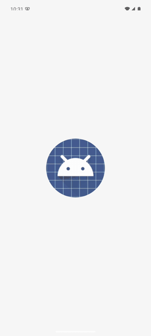

<div align="center">

# Moji termini

**Android zadatak za tehnički razgovor**




</div>

---

## Čestitamo!

Čestitamo na prolasku u sljedeći krug selekcije! Drago nam je što te možemo bolje upoznati. Ovaj zadatak nam pomaže vidjeti kako razmišljaš i radiš na stvarnom kodu, a na razgovoru ćemo kroz njega proći zajedno. Hvala ti što si odvojio/la vrijeme za njega.

## Ukratko

| | |
|---|---|
| **Procijenjeno vrijeme** | 3–4 sata |
| **Obavezni dio** | Detalj termina |
| **Predaja** | Privatni repozitorij + pozivnica za `sarcevic-luka` i `ivevasiljevic` |
| **Uz rješenje** | `SOLUTION.md` s kratkim opisom |
| **Kontakt** | [luka.sarcevic@crosig.hr](mailto:luka.sarcevic@crosig.hr) |

## O aplikaciji

**Moji termini** je mala aplikacija u kojoj pacijent vidi svoje termine kod liječnika i naručuje nove. Aplikacija je napisana na brzinu: otprilike radi, ali ima bugova, nije dovršena i kod nije spreman za produkciju.

Aplikacija nema pravi backend. `NetworkManager` čita podatke iz `appointments.json` i `doctors.json` (u `app/src/main/assets`) i glumi kašnjenje servera.

## Što trebaš napraviti

1. **Napravi otvaranje detalja termina** *(obavezno)*. Trenutno se ništa ne dogodi kad tapneš na termin. Detalj neka pacijentu pokaže sve što mu treba za taj termin, a kako će izgledati i što će sve imati, prepuštamo tebi.
2. **Popravi ono što ne valja.** Bugovi, rušenja, čudno ponašanje, loš kod: što god primijetiš.
3. **Poboljšaj kod i dojam aplikacije.** Želimo vidjeti kako bi ti napravio/la aplikaciju koju bi rado pustio/la u produkciju i koju je ugodno koristiti. Vizualni dio je jednako važan kao i kod.
4. **Istestiraj aplikaciju.** Prođi je kao korisnik i kao tester: različite veličine ekrana, postavke sustava i situacije kad nešto pođe po zlu. Za logiku koju smatraš rizičnom dodaj automatske testove.
5. **Razmišljaj unaprijed.** Aplikacija će s vremenom dobiti pravi backend, prijavu i više korisnika. Što bi pripremio/la već sad, a što bi svjesno ostavio/la za kasnije?

Ne očekujemo da popraviš baš sve. Više nas zanima što prvo primijetiš i kako odlučiš što je najvažnije nego da je sve savršeno.

## Što gledamo

Zamisli da ti predajemo ovaj task u stvarnom timu: želimo vidjeti da ga možemo prepustiti tebi i znati da će biti temeljito odrađen.

- **Kvaliteta koda i arhitektura:** čitljivost, struktura i odluke koje znaš obrazložiti.
- **Izgled i dojam:** koliko je aplikacija ljepša, jasnija i ugodnija za korištenje nego prije.
- **Testiranje:** kako si provjerio/la da sve radi, ručno i automatskim testovima.
- **Proaktivnost:** što si primijetio/la i riješio/la a da to nigdje nije pisalo.
- **Razmišljanje unaprijed:** koje rizike vidiš i kako si aplikaciju pripremio/la za budućnost.

Slobodno koristi AI alate, ali nas zato više zanima tvoja prosudba: što si provjerio/la, što si odbacio/la i zašto.

## Imaš potpunu slobodu

- Projekt možeš restrukturirati kako god želiš: arhitektura, organizacija koda, podjela na module, dizajn.
- Možeš dodavati nove stvari koje misliš da aplikaciji nedostaju.
- Možeš mijenjati `NetworkManager` i lažne podatke, ali neka aplikacija i dalje radi bez pravog servera.
- Možeš koristiti vanjske biblioteke ako znaš objasniti zašto.
- Slobodno koristi Claude, Copilot, ChatGPT ili što inače koristiš u radu.

## Pokretanje

Potrebni su Android Studio Ladybug (2024.2) ili noviji, JDK 17 i emulator ili uređaj s Androidom 8.0+.

```bash
git clone https://github.com/sarcevic-luka/moji-termini-android.git
cd moji-termini-android
```

U Android Studiju odaberi **File → Open** i mapu projekta. Kad Gradle završi sinkronizaciju, odaberi emulator i pokreni aplikaciju (⌃R). Iz terminala je možeš i buildati s `./gradlew assembleDebug`.

## Predaja

> [!IMPORTANT]
> **Nemoj forkati ovaj repozitorij** niti objavljivati rješenje javno. Fork javnog repozitorija na GitHubu uvijek je javan, pa bi tvoje rješenje mogli vidjeti drugi kandidati.

1. Rješenje drži u **vlastitom privatnom** repozitoriju. Ako koristiš [GitHub CLI](https://cli.github.com), iz kloniranog projekta:
   ```bash
   git remote rename origin upstream
   gh repo create moji-termini-android --private --source=. --push
   ```
2. U root projekta dodaj **`SOLUTION.md`** s kratkim opisom:
   - što si popravio/la i zašto,
   - što si dodao/la ili promijenio/la,
   - kako si testirao/la aplikaciju i što si time pronašao/la,
   - koje probleme predviđaš u budućnosti i kako bi ih spriječio/la,
   - što bi napravio/la da imaš više vremena,
   - kako si koristio/la AI alate, ako jesi.
3. Kad završiš, u svom repozitoriju otvori **Settings → Collaborators** i pozovi korisnike **`sarcevic-luka`** i **`ivevasiljevic`** kao suradnike (reviewere), pa nam na [luka.sarcevic@crosig.hr](mailto:luka.sarcevic@crosig.hr) javi da si poslao/la pozivnice.

Volimo vidjeti i povijest commitova, pa ne moraš sve spojiti u jedan commit.

## Što slijedi

Na tehničkom razgovoru zajedno ćemo proći kroz tvoje rješenje: što si promijenio/la, zašto, i što bi napravio/la drugačije.

Ako ti nešto nije jasno, slobodno se javi na [luka.sarcevic@crosig.hr](mailto:luka.sarcevic@crosig.hr). Veselimo se tvom rješenju i razgovoru.

<div align="center">

**Sretno!**

</div>
